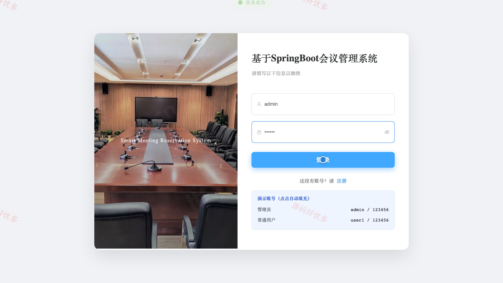
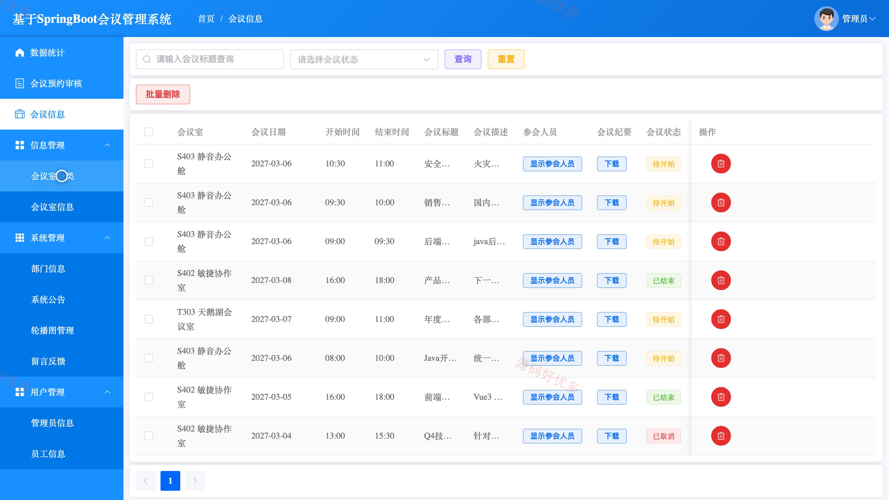
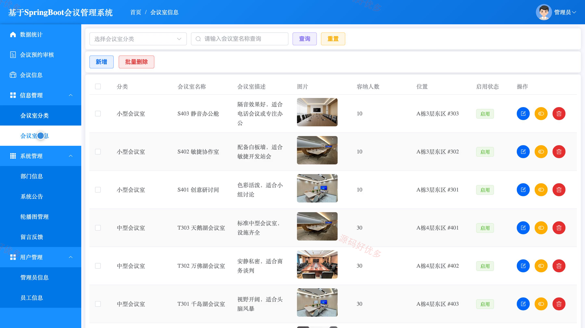
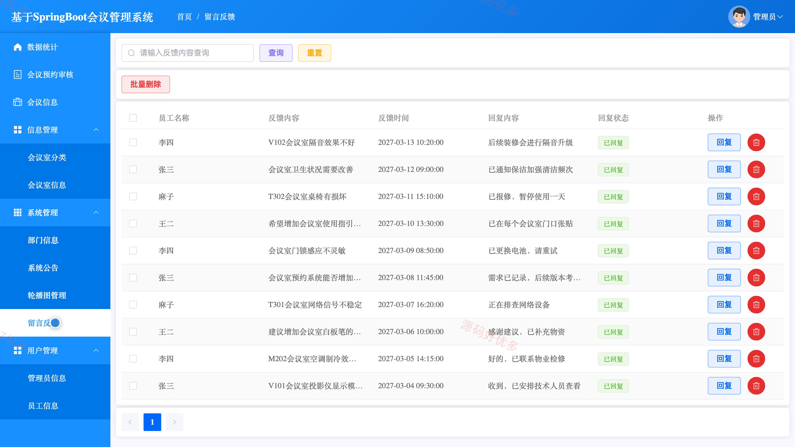
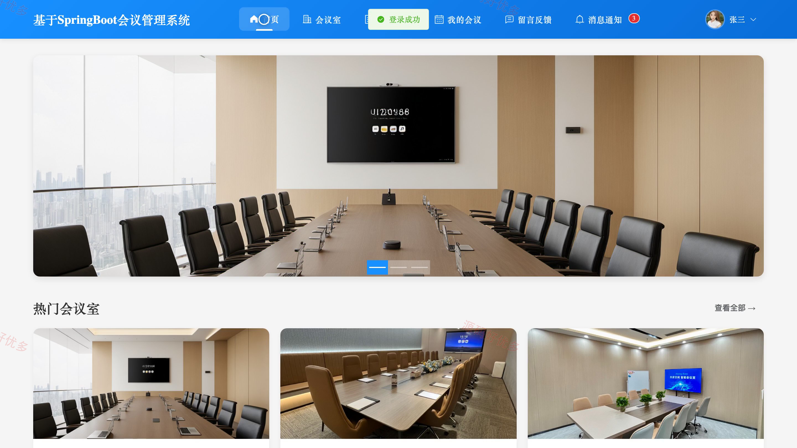
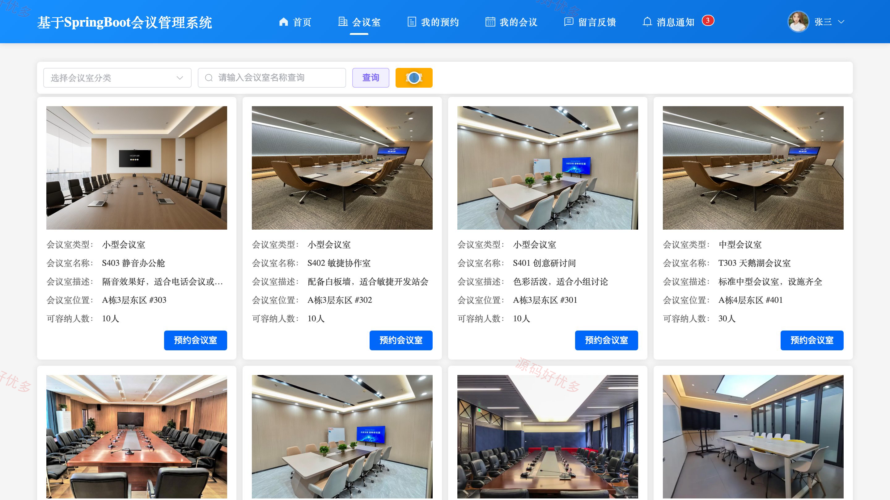
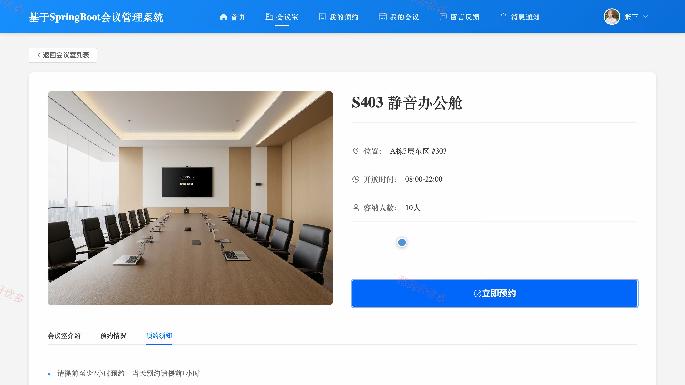
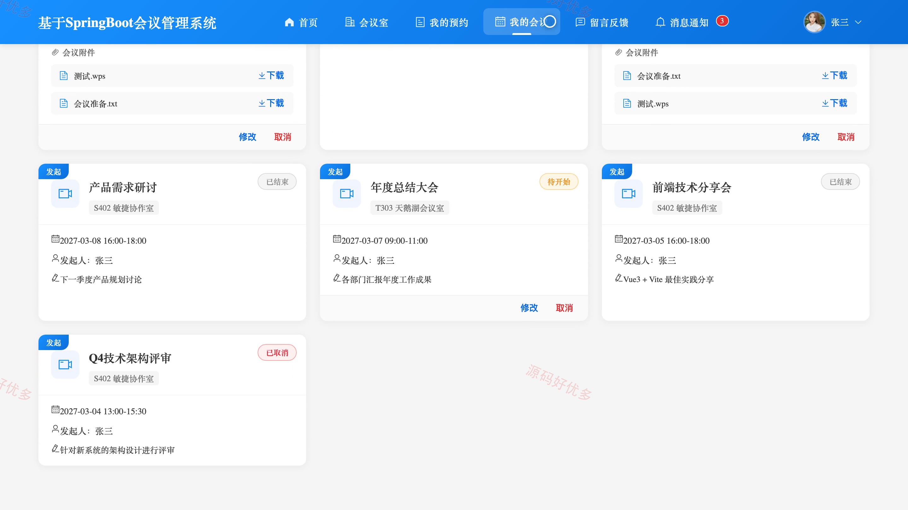

# bs143A
bs143A会议室预约系统源码 Java SpringBoot3 Vue3 前后分离 设计文档
## 源码问题查看主页咨询

### 一、关键词
会议室预约、会议安排、场地预订、办公资源管理、会议日程

### 二、作品包含
源码+数据库+万字设计文档+PPT+全套环境和工具资源+本地部署教程

### 三、项目技术
前端技术： Html、Css、Js、Vue3.4、Element-Plus
后端技术：Java、SpringBoot3.3.1、MyBatis

### 四、运行环境要求
开发工具：IDEA/eclipse + VSCODE

数据库：MySQL5.7+（共11张表）

数据库管理工具：Navicat10以上版本

环境配置软件： JDK21 + Maven3.6

前端Nodejs：20

浏览器：谷歌浏览器

### 五、项目介绍
项目编号：bs143A

会议室预约系统面向员工和管理员，支持会议室查询、时段预约、审批和参会安排，帮助组织管理场地与会议日程。

角色：用户、管理员

用户功能：会议室浏览与查询、提交会议室预约、查看与取消本人预约、查看与维护我的会议、查看会议通知、提交留言反馈。

管理员功能：会议室与分类管理、预约审核、会议信息管理、员工与部门管理、公告和轮播管理、留言反馈处理、数据统计。

### 六、运行截图

